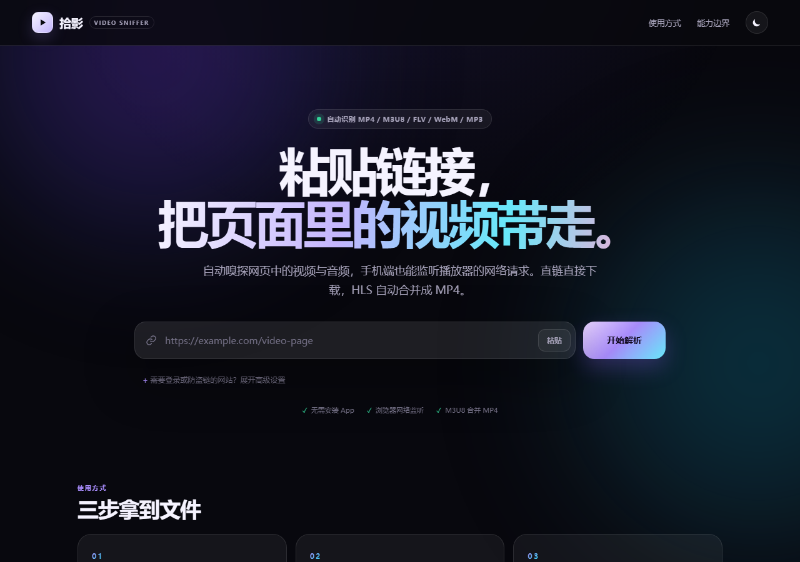
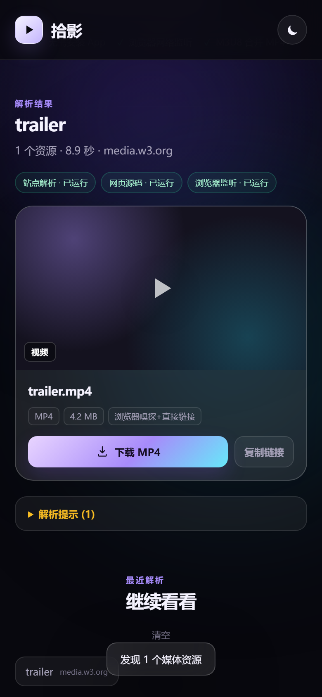
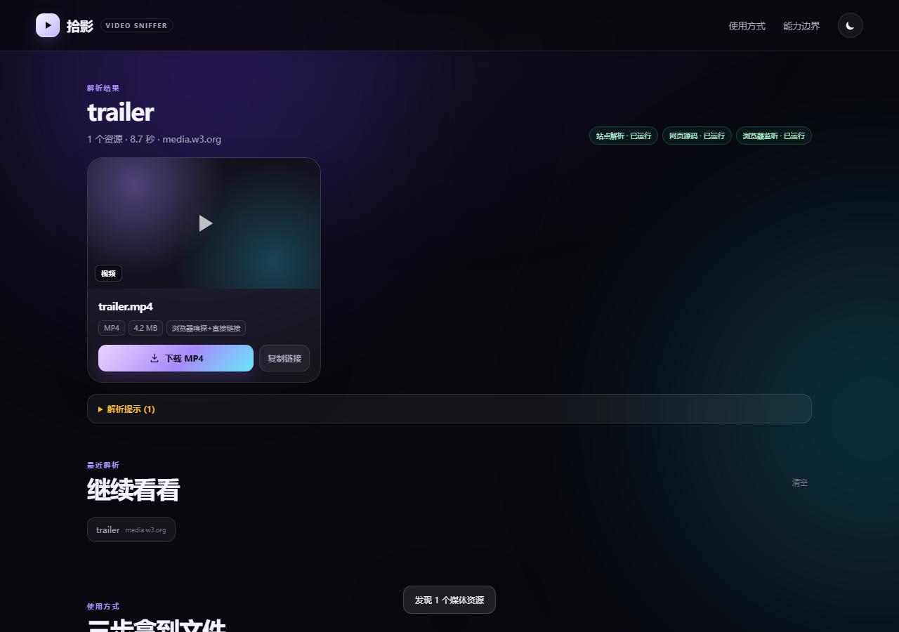

# 拾影 · 网页视频嗅探下载

粘贴一个网页链接，自动找出页面里的视频和音频，并在浏览器里直接下载。手机端也能用，适合处理“电脑上能嗅探、手机上不方便操作”的场景。

## 界面预览

| 桌面端 | 移动端 |
| --- | --- |
|  |  |

解析结果：



## 工作原理

解析分两层：

1. **平台专用解析（抖音 / TikTok）**：先把分享文案里的链接提取出来，跟随 `v.douyin.com`、`vm.tiktok.com` 等短链跳转，再走对应平台的解析路径。
   - 抖音：用 Playwright 打开作品页，读取页面里的 `play_addr`，转换成去水印的 `/aweme/v1/play/` 直链，返回 1080P、720P 和 MP3 选项。
   - TikTok：用 yt-dlp 解析无水印音视频，下载时自动选择最佳画质并合并或提取 MP3。
2. **通用网页嗅探（其他站点）**：yt-dlp 站点解析 + HTML 源码识别 + Playwright 手机 UA 监听，三层结果合并去重。HTML 层识别 `<video>`、`<source>`、`<audio>`、Open Graph、JSON-LD、转义后的 M3U8/MP4 地址；浏览器层监听播放器实际发出的视频、音频和 M3U8 请求。

结果会合并去重：直链走流式代理下载；M3U8、分轨视频和需要 Cookie 的站点走后台任务，用 yt-dlp + ffmpeg 合并成 MP4，音频转 MP3。

> [Douyin_TikTok_Download_API](https://github.com/Minerchu/Douyin_TikTok_Download_API) 提供了抖音/TikTok 专用接口的思路。本项目没有直接照搬它依赖的旧接口，而是把平台解析做成独立 provider：抖音走当前作品页数据 + 去水印直链，TikTok 走 yt-dlp，避免接口过期后整个功能失效。

## 功能

- 移动优先的响应式网页，手机浏览器直接使用
- 抖音分享文案 / 短链直接粘贴，返回去水印 1080P、720P 和 MP3
- TikTok 视频无水印下载、MP3 提取，支持 `vm.tiktok.com` 短链
- MP4 / FLV / WebM / MOV / MP3 / M4A / HLS(M3U8) / DASH(MPD) 识别
- 直链下载、流式代理、Range 透传
- HLS 后台合并 MP4，音频后台转 MP3
- 下载任务进度条、失败重试、文件生成后再次下载
- 高级设置支持临时 Cookie / Referer，适配登录和防盗链站点
- 最近解析记录只保存在浏览器 localStorage
- 深色/浅色主题
- SSRF 防护、大小上限、临时文件自动清理、基础安全响应头

## 快速开始

Windows PowerShell：

```powershell
cd video-sniffer
.\run.ps1
```

如果系统提示“禁止运行脚本”，用下面任一方式启动：

```powershell
powershell -ExecutionPolicy Bypass -File .\run.ps1
```

或者直接双击 `start.bat`。

打开 `http://127.0.0.1:8765`。

`run.ps1` 会自动：

- 创建 `.venv`
- 安装 `requirements.txt`
- 安装 Playwright Chromium
- 启动 Uvicorn

手机访问：确保手机和电脑在同一局域网，使用 `http://<电脑局域网IP>:8765`，并在 Windows 防火墙放行该端口。启动脚本默认监听 `0.0.0.0`。

### 手动启动

```powershell
py -3.12 -m venv .venv
.\.venv\Scripts\python.exe -m pip install -r requirements.txt
.\.venv\Scripts\python.exe -m playwright install chromium
.\.venv\Scripts\python.exe -m uvicorn app.main:app --host 0.0.0.0 --port 8765 --reload
```

需要 Python 3.11+，推荐 3.12。ffmpeg 会优先使用系统命令；没有时自动使用 `imageio-ffmpeg` 自带的二进制，也可以通过 `FFMPEG_PATH` 指定。

## 使用方式

1. 粘贴视频页、文章页或分享页链接；抖音/TikTok 可以直接粘贴整段分享文案。
2. 点击“开始解析”，等待三层嗅探合并结果。
3. 直链点击“下载文件”；HLS 或站点解析结果点击“合并下载 MP4”/“下载 MP3”，等待进度完成。
4. 如果页面需要登录，展开“高级设置”，从浏览器开发者工具复制 Cookie 粘贴进去。Cookie 只随请求发送，不写入服务器磁盘。

## 项目结构

```text
video-sniffer/
├─ app/
│  ├─ main.py           FastAPI 路由、下载代理、任务接口
│  ├─ sniffer.py        通用嗅探、结果合并、去重、元数据补全
│  ├─ platforms.py      抖音/TikTok 专用解析、分享链接归一化
│  ├─ downloader.py     yt-dlp + ffmpeg 后台下载任务
│  ├─ security.py       SSRF 防护、文件名与请求头清洗
│  ├─ models.py         Pydantic 请求/响应模型
│  └─ config.py         配置、ffmpeg 定位、临时目录
├─ static/
│  ├─ index.html        单页界面
│  ├─ styles.css        移动优先样式
│  └─ app.js            解析、渲染、下载进度、历史记录
├─ tests/               单元测试
├─ run.ps1              Windows 一键启动
├─ Dockerfile
└─ docker-compose.yml
```

## API

### `POST /api/parse`

```json
{
  "url": "https://example.com/video-page",
  "cookie": "optional",
  "referer": "optional"
}
```

返回 `items` 数组，每个条目包含：

- `kind`: `video` / `audio` / `hls` / `live`
- `mode`: `proxy`（直链代理）或 `job`（后台合并）
- `format`, `quality`, `width`, `height`, `duration`, `size`
- `url`, `format_selector`, `referer`
- `source`: 抖音解析 / TikTok解析 / 站点解析 / 网页源码 / 浏览器嗅探

抖音直链是带时效的 CDN 地址，建议解析后尽快下载；失效后重新点“开始解析”即可重新生成。受登录、私密作品、DRM 或付费限制的内容不会绕过权限。

### `POST /api/jobs`

创建下载任务，用于 HLS、分轨视频、需要 Cookie 的媒体。

```json
{
  "url": "https://example.com/page-or-manifest",
  "title": "optional",
  "format_selector": "bestvideo*+bestaudio/best",
  "kind": "video",
  "referer": "optional",
  "cookie": "optional"
}
```

### 其他接口

- `GET /api/jobs/{id}`：任务状态与进度
- `GET /api/jobs/{id}/file`：下载生成的文件
- `DELETE /api/jobs/{id}`：删除任务与临时文件
- `GET /api/download?url=...&filename=...&referer=...`：直链流式代理下载
- `GET /api/health`：运行环境、ffmpeg、Playwright、yt-dlp 状态
- `GET /docs`：FastAPI 自动接口文档

## 配置

复制 `.env.example` 为 `.env`，或直接设置环境变量：

| 变量 | 默认值 | 说明 |
| --- | --- | --- |
| `MAX_DOWNLOAD_MB` | `2048` | 单文件大小上限 |
| `MAX_MEDIA_ITEMS` | `40` | 单次最多返回条目 |
| `SNIFF_TIMEOUT_SECONDS` | `45` | 单次解析总超时 |
| `JOB_TTL_SECONDS` | `7200` | 临时文件保留时间 |
| `ENABLE_PLAYWRIGHT` | `1` | 是否启用浏览器监听 |
| `ALLOW_PRIVATE_NETWORK` | `0` | 生产环境必须保持 0 |
| `FFMPEG_PATH` | 自动 | 自定义 ffmpeg 路径 |

> 当前代码放行了 `198.18.0.0/15`，用于兼容部分沙箱/代理环境的出网 DNS 映射；真实私网、回环、链路本地和云元数据地址仍然会被拒绝。

## 能力边界

- **不能破解 DRM**：Widevine、FairPlay、PlayReady 等加密流需要正版密钥，本项目不做绕过。
- **不能绕过登录或付费墙**：需要登录的内容只能使用你自己的有效 Cookie。
- **部分站点会失败**：反爬、风控、验证码、Region Lock、短时签名地址都可能让解析失败。
- **直播流**：可以尝试录制，但不保证完整；长直播会触发大小和超时限制。
- **iOS 保存**：Safari 可能先打开播放器，需要点“下载”后到“文件”App 或分享菜单保存到相册。
- **带宽与磁盘**：HLS 合并会先在服务器临时落盘，请关注磁盘空间和并发任务数。

请只下载你有权保存的内容，并遵守目标网站服务条款和当地法律。

## Docker 部署

```bash
docker compose up -d --build
```

默认映射 `8765:8000`，临时文件在 `.tmp/`。Chromium 在容器里需要 `shm_size: "1gb"`，`docker-compose.yml` 已配置。

生产部署建议再加：

- Nginx/Caddy 反向代理与 HTTPS
- 访问认证（Basic Auth 或登录系统）
- 按 IP/用户限流
- Redis + 队列，把下载任务从单进程内存迁出
- 对象存储或定期清理策略
- 日志脱敏，避免记录 Cookie

## 测试

```powershell
.\.venv\Scripts\python.exe -m pytest -q
```

当前测试覆盖 SSRF、文件名清洗、格式选择器、HTML 媒体提取、去重合并和下载模式切换。

## 下一步可以做什么

- 接入 `Douyin_TikTok_Download_API` 作为专用 provider，提升抖音/TikTok 成功率
- 增加 B站扫码登录/Cookie 持久化
- 任务队列与持久化，支持多用户和并发配额
- 视频预览、字幕/封面单独下载
- PWA 安装与分享目标（手机分享链接直接打开）
- 站点适配器插件机制：`generic` / `yt-dlp` / `douyin` / `bilibili`
